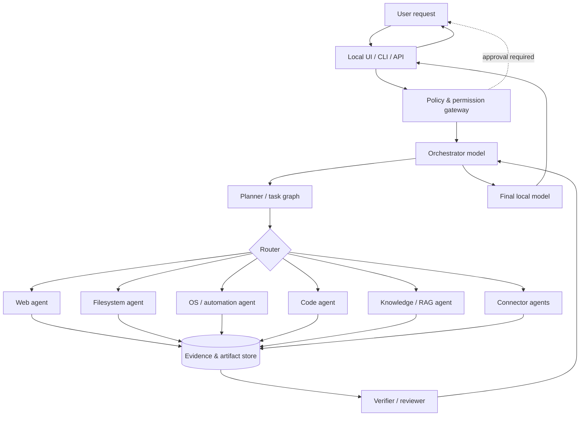
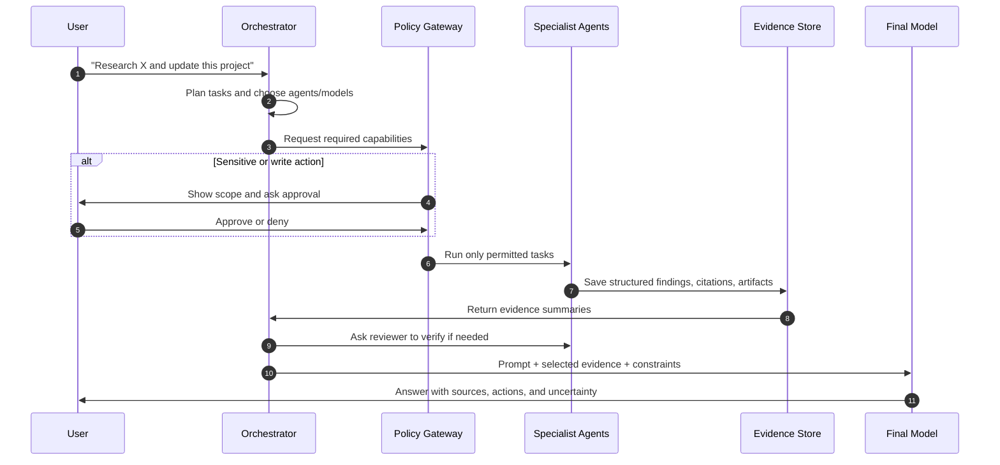

# Local Multi-Agent Runtime

> Give local language models the practical capabilities of cloud assistants—while keeping model choice, data, and permissions under the user's control.

## The idea

Local models are increasingly capable, but a standalone chat model cannot reliably browse the web, inspect a directory, run a command, search a knowledge base, or coordinate long tasks. This project is a local-first runtime where **specialist agents** perform those bounded jobs and return verified, structured results to a **coordinator**. The coordinator synthesizes those results into the final response from the user's chosen local model.

Instead of expecting one model to be excellent at everything, the system creates a small team:

- A strong local **orchestrator** understands the request, plans work, delegates it, and writes the answer.
- Focused **capability agents** have narrowly scoped tools: web research, files, operating system actions, code execution, knowledge retrieval, and more.
- Optional **reviewer agents** validate important claims, check citations, or assess whether an action is safe before it reaches the user.

The goal is not merely tool calling. It is a portable environment in which different local models can collaborate, each used where it is most effective, without making a cloud model the control plane.

## Why this approach

| Challenge with a single local model | Multi-agent runtime response |
| --- | --- |
| One model has to reason, use tools, and write the answer at once | Delegate tool-heavy work to specialized agents, then synthesize |
| Smaller models can hallucinate tool results | Require agents to return typed evidence, source links, command output, and confidence |
| Broad OS access is risky | Grant capability-specific, revocable permissions and require approval for sensitive actions |
| A model may be better at coding than research—or vice versa | Route each task to the appropriate locally hosted model |
| Long tasks exceed a single context window | Keep compact task state, artifacts, and evidence outside the final model context |

## What it does

The runtime accepts a natural-language request, decomposes it into tasks, executes those tasks through permissioned agents, validates their outputs, and gives the final local model a concise evidence bundle to answer from.

Potential capabilities include:

- **Web agent:** search, fetch pages, extract clean text, cite sources, and flag stale or conflicting information.
- **File agent:** list, read, search, summarize, and—with explicit authorization—edit files within approved workspace roots.
- **OS agent:** inspect local system state and perform approved actions through an allowlisted command or automation layer.
- **Code agent:** inspect repositories, run tests, propose patches, and report build/test evidence.
- **Knowledge agent:** retrieve from local documents, embeddings, databases, or notes.
- **Browser / connector agents:** interact with authenticated services through narrowly scoped connectors such as calendars, email, cloud drives, issue trackers, or smart-home systems.
- **Reviewer agents:** independently verify research, policy compliance, task completion, or output quality.

## Architecture



### Core components

1. **Local model gateway** — a provider-neutral interface for local inference servers (for example Ollama, llama.cpp, vLLM, or LM Studio). It exposes model capabilities, context limits, cost/latency metrics, and structured-output support.
2. **Orchestrator** — the control plane. It turns a user request into a task graph, selects agents/models, tracks dependencies, handles retries, and decides when enough evidence exists to respond.
3. **Agent runtime** — a standard contract for agents: declared tools, permission requirements, input/output schemas, time limits, and an isolated execution context.
4. **Tool and connector layer** — adapters for web, filesystem, shell/OS, browser automation, retrieval, and third-party services. Tools never become implicitly available to every model.
5. **Policy gateway** — enforces identity, workspace boundaries, allowlists, rate limits, secrets handling, audit logging, and approval checkpoints before any side effect.
6. **Artifact and memory store** — persists task state, retrieved evidence, citations, tool transcripts, generated files, and compact long-term project memory. This lets the final model consume facts instead of huge raw traces.
7. **Verifier** — checks source quality, schema validity, consistency, and completion criteria. High-risk work can require a second independent agent or explicit user confirmation.
8. **UI / API** — starts runs, renders plans and approvals, streams progress, shows citations, and makes every tool action inspectable.

## End-to-end workflow



## Agent contract

Every agent should be predictable and composable. A minimal agent interface can look like this:

```json
{
  "agent": "web-research",
  "capabilities": ["web.search", "web.fetch"],
  "input": {
    "task": "Compare two local inference servers",
    "constraints": { "max_sources": 6, "recency_days": 180 }
  },
  "output": {
    "status": "completed",
    "summary": "...",
    "evidence": [{ "url": "https://…", "claim": "…", "excerpt": "…" }],
    "artifacts": [],
    "confidence": 0.84,
    "limitations": []
  }
}
```

Important design rules:

- Agents return **evidence and artifacts**, not unsupported prose alone.
- The orchestrator passes only relevant, sanitized context to each agent.
- Outputs are schema-validated before another component relies on them.
- Agents can request more access, but cannot silently expand their own permissions.
- The final answer distinguishes verified facts, inference, and uncertainty.

## Security and privacy model

Local-first does not automatically mean safe: a model with unrestricted shell access can still delete files or leak secrets through a malicious webpage. The system should make authority explicit.

- **Least privilege:** agents receive only the tool, directory, domain, and operation required for one task.
- **Read/write separation:** reading a file and modifying it are different capabilities; writes, deletes, installs, and external messages require confirmation by default.
- **Sandboxed execution:** run shell/code agents in containers or OS sandboxes with CPU, memory, network, and filesystem limits.
- **Workspace roots:** restrict file tools to user-selected directories; block parent traversal and sensitive locations by default.
- **Command allowlists:** favor structured operations over arbitrary shell. When shell is necessary, display the exact command and working directory.
- **Secret isolation:** connectors resolve credentials outside the model context. Models see neither raw tokens nor secret files.
- **Prompt-injection defenses:** treat webpages, documents, and tool output as untrusted data; never let them override system policy or grant permissions.
- **Auditable runs:** log task plans, permissions, tool calls, approval decisions, and generated artifacts locally.
- **Human control:** users can pause, cancel, inspect, or rerun any task; irreversible actions always have a clear checkpoint.

## Model strategy

Use models as interchangeable workers rather than tying the project to one model family.

| Role | Desired traits | Example routing criterion |
| --- | --- | --- |
| Orchestrator | reliable instruction following, tool planning, structured output | strongest available local general model |
| Web/file agents | extraction, concise summarization, tool reliability | low latency and good JSON adherence |
| Code agent | repository reasoning, patch quality, test repair | code-specialized model |
| Reviewer | skepticism, consistency checking | use a different model than the producer when possible |
| Final model | clear writing, synthesis, user tone | best available context window and generation quality |

Start with one model running all roles behind distinct prompts and permissions. Add heterogeneous models only after the task protocol and evaluations are stable—otherwise routing complexity can mask basic reliability problems.

## Suggested implementation plan

### Phase 0 — Define the contract

- Choose a first supported local inference backend.
- Define task, agent result, evidence, artifact, and approval schemas.
- Establish a threat model and a small permission vocabulary (`web.read`, `files.read`, `files.write`, `shell.run`, etc.).
- Create 10–20 representative end-to-end tasks as an evaluation suite before building many agents.

### Phase 1 — Read-only MVP

Build a CLI or local web UI with an orchestrator plus three read-only agents: web search/fetch, workspace file search/read, and local knowledge retrieval. Store structured evidence and show the user the plan, tools used, and citations. This proves delegation, routing, and synthesis without dangerous side effects.

**Definition of done:** a user can ask a research or repository question; the system plans it, gathers traceable evidence, and produces a cited answer locally.

### Phase 2 — Reliable task execution

- Add a task graph with parallel independent steps, deadlines, retries, cancellation, and resumable state.
- Add structured output validation and a reviewer loop for research and code tasks.
- Add an artifact store and a run timeline for debugging.
- Measure task success, citation correctness, latency, context use, and human intervention rate.

### Phase 3 — Controlled write capabilities

- Add patch proposals, test execution, and explicit diff approval.
- Add filesystem writes restricted to approved workspace roots.
- Add a sandboxed OS/code runner with command previews and allowlists.
- Add policy tests for path escapes, command injection, secret access, and prompt injection.

### Phase 4 — Extensible ecosystem

- Publish an agent/connector SDK with manifests and versioned schemas.
- Add connector consent screens, credential vault integration, and per-connector scopes.
- Support model routing policies, model fallback, and optional remote providers without changing the security boundary.
- Build reusable agent packs for research, software development, document analysis, and personal productivity.

## Proposed repository shape

```text
local-multiagents/
├── apps/                 # CLI, desktop, or web interface
├── packages/
│   ├── core/             # task graph, schemas, orchestration
│   ├── model-gateway/    # adapters for local inference servers
│   ├── policy/           # permissions, approvals, audit log
│   ├── agent-sdk/        # agent manifest and runtime contract
│   └── storage/          # evidence, artifacts, memory
├── agents/
│   ├── web/
│   ├── filesystem/
│   ├── code/
│   ├── os/
│   └── reviewer/
├── connectors/           # optional external integrations
├── evals/                # task fixtures, safety tests, scorecards
├── docs/                 # architecture and contributor docs
└── examples/             # complete local workflows
```

## First milestone: a useful vertical slice

Build this before attempting broad OS control or many connectors:

1. A user asks: “Inspect this repository and research the best way to add feature X.”
2. The orchestrator creates two parallel, read-only tasks: repository inspection and web research.
3. Each agent returns schema-validated findings with file references or web citations.
4. A reviewer checks that the recommendation is supported and highlights conflicts.
5. The final model produces a plan, with evidence links and a proposed patch—but makes no changes until the user approves.

This vertical slice exercises the entire architecture: model routing, tool boundaries, evidence handling, coordination, transparency, and human approval.

## Success criteria

The project is succeeding when it can consistently demonstrate that:

- users can understand what the system is doing and why;
- sensitive actions never happen outside the granted scope;
- final answers trace important claims back to tool evidence;
- failures are visible, recoverable, and useful for debugging;
- adding a new model or agent does not require rewriting the orchestrator; and
- a small local setup remains genuinely useful even without any cloud service.

## Open design questions

- Which runtime is the initial target: a single Python service, a TypeScript/Node runtime, or a desktop application?
- Which local model backends should be first-class, and which structured-output guarantees can each make?
- Should the task graph be model-generated, rule-assisted, or both?
- How will connector manifests express permissions and data retention?
- What evidence format makes citations and tool traces easy to inspect without overwhelming users?
- Which tasks will be the canonical benchmark for usefulness, safety, and latency?

## Guiding principle

**Models can propose and coordinate; the runtime enforces authority.**

That separation is what makes a capable local multi-agent system trustworthy enough to connect to real files, browsers, operating systems, and personal services.
